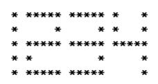
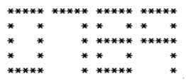

# 題目 1. 矩陣數字顯示

> ITSA 基礎題練習 · 第 0000 輪 · [回到本輪目錄](../README.md)

**程式碼檔案：** [solution.cpp](solution.cpp)

---

問題描述  
現有一可顯示四位數字的 LED 燈一組，可根據輸入的四位數字顯示數字。比如說，  
由鍵盤輸入 1234 ，則可在螢幕上顯示  
  
若輸入 0789 ，則顯示  
  
輸入格式  
輸入格式為 四個整數。  
輸出格式  
輸出值為輸入值的矩陣數字。  

```cpp
#include <iostream>

using namespace std;

int main()
{
    int n = 0;
    string num[10][5][5] = {{{"*", "*", "*", "*", "*"}, {"*", " ", " ", " ", "*"}, {"*", " ", " ", " ", "*"},{"*", " ", " ", " ", "*"}, {"*", "*", "*", "*", "*"}},
    {{" ", " ", " ", " ", "*"}, {" ", " ", " ", " ", "*"}, {" ", " ", " ", " ", "*"}, {" ", " ", " ", " ", "*"}, {" ", " ", " ", " ", "*"}},
    {{"*", "*", "*", "*", "*"}, {" ", " ", " ", " ", "*"}, {"*", "*", "*", "*", "*"}, {"*", " ", " ", " ", " "}, {"*", "*", "*", "*", "*"}},
    {{"*", "*", "*", "*", "*"}, {" ", " ", " ", " ", "*"}, {"*", "*", "*", "*", "*"}, {" ", " ", " ", " ", "*"}, {"*", "*", "*", "*", "*"}},
    {{"*", " ", " ", " ", "*"}, {"*", " ", " ", " ", "*"}, {"*", "*", "*", "*", "*"}, {" ", " ", " ", " ", "*"}, {" ", " ", " ", " ", "*"}},
    {{"*", "*", "*", "*", "*"}, {"*", " ", " ", " ", " "}, {"*", "*", "*", "*", "*"}, {" ", " ", " ", " ", "*"}, {"*", "*", "*", "*", "*"}},
    {{" ", " ", " ", " ", "*"}, {" ", " ", " ", " ", "*"}, {"*", "*", "*", "*", "*"}, {"*", " ", " ", " ", "*"}, {"*", "*", "*", "*", "*"}},
    {{"*", "*", "*", "*", "*"}, {" ", " ", " ", " ", "*"}, {" ", " ", " ", " ", "*"}, {" ", " ", " ", " ", "*"}, {" ", " ", " ", " ", "*"}},
    {{"*", "*", "*", "*", "*"}, {"*", " ", " ", " ", "*"}, {"*", "*", "*", "*", "*"}, {"*", " ", " ", " ", "*"}, {"*", "*", "*", "*", "*"}},
    {{"*", "*", "*", "*", "*"}, {"*", " ", " ", " ", "*"}, {"*", "*", "*", "*", "*"}, {" ", " ", " ", " ", "*"}, {" ", " ", " ", " ", "*"}}};

    while (cin >> n)
    {
        for(int i = 0; i < 5; i++) //將每個數字固定由上排到下排執行
        {
            int output = n;
            int w = 1000;
            for(int k = 0; k < 4; k++)
            {
                int number = 0;
                number = output / w;
                output %= w;
                w /= 10;
                for(int j = 0; j < 5; j++)
                {
                    cout << num[number][i][j];
                }
                if(k != 3) cout << " ";
            }
            cout << endl;
        }
    }
    return 0;
}
```cpp
