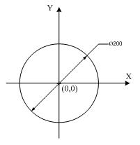

# 題目3. 判斷座標是否在圓形的範圍內

> ITSA基礎題練習 · 第0415輪 · [回到本輪目錄](../README.md)

**程式碼檔案**：[solution.cpp](solution.cpp)

---

問題描述：  
有一圓形，直徑為200，且中心座標為(0,0)。請寫一支程式可以輸入「點」的座標，並判斷「點」是否在圓形的範圍內。如果「點」的位置剛好在邊界的話也算是在圓形範圍內(例：x=100，y=0)。  
  
輸入說明：  
輸入一整數座標，依序分別X與Y。  
輸出說明：  
輸出此座標位置在圓內或圓外訊息。  
範例：  

| 輸入範例: | 輸出範例: |
|---|---|
| 50 50<br>200 200 | inside<br>outside |

> 💡 **筆記**  
>
> x^2 + y^2 ≤ r^2這是判斷的數學方程式  

```cpp
#include <iostream>

using namespace std;

int main()
{
    int m, n;
    while(cin >> n >> m)
    {
        if(n * n + m * m <= 10000)//x^2 + y^2 ≤ r^2這是判斷的數學方程式
        {
            cout << "inside" << endl;
        }
        else
        {
            cout << "outside" << endl;
        }
    }
    return 0;
}

```cpp
