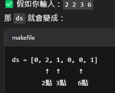

# 題目 37. 18啦遊戲設計

> ITSA 基礎題練習 · 第 0415 輪 · [回到本輪目錄](../README.md)

**程式碼檔案：** [solution.cpp](solution.cpp)

---

問題描述 ：  
有一種仿間常見的遊戲稱為 "18 啦 "~ 玩法介紹 : 由四個骰子來擲，只要其中任兩個是相同點，才開始計算點數，點數即為另兩個點數相加，若另兩個也一樣，則取較大的一組相加，另外有下列幾種特殊情況 :  
1. 擲出 4 顆骰子點數均相同，稱為通殺 !  
2. 任三顆點數相同或四顆點數均不相同，即為無意義 !  
請寫一程式，各別輸入四顆骰子點數，判斷結果 !  
輸入說明 ：  
各別輸入四次骰出的點數 ，一行輸入一次，輸入的點數為 1~6 之間 。  
輸出說明 ：  
若是通殺，則顯示大寫英文字母 WIN ， 若是無意義 ，則 顯示大寫英文字母 R ，若可計算點數，則顯示最後點數 。 輸出結果前後均不需留空格 。  
範例 ：  

| 輸入範例 | 輸出範例 |
|---|---|
| 2<br>3<br>4<br>5 | R |
| 3<br>4<br>3<br>4 | 8 |

> 💡 **筆記**  
>
> 你會輸入 4 個骰子點數（範圍是 1~6），  
> 程式會根據骰子出現的次數，判斷以下幾種狀況：  
> - 出現四顆一樣 → 輸出 WIN  
> - 出現三顆一樣 → 輸出 R  
> - 出現兩組兩顆 → 輸出 兩個點數的加總 ×2  
> - 出現一組兩顆（其他不同）→ 輸出兩個不同點數的加總  
> - 其他狀況 → 輸出 R  

| 變數 | 代表意思 |
|---|---|
| ds[6] | 每種點數出現次數 |
| d[3] | 存每種點數和次數（如 31） |
| d[2] % 10 | 最多那個點數出現幾次 |
| d[i] / 10 | 那個點數是多少（例如 31 ➜ 3） |

  

```cpp
#include<iostream>
using namespace std;

int main()
{
    int ds[6] = {0};
    int a = 0;
    for(int j = 0; j < 4; j++)
    {
        cin >> a;
        for(int i = 0; i < 6; i++)
        {
            if(i + 1 == a){
                ds[i]++;
                break;
            }
        }
    }

    int d[3] = {0};
    a = 2;
    for(int i = 0; i < 6; i++)
    {
        if(ds[i] > 0)
        {
            d[a] = (i + 1) * 10 + ds[i];
            a--;
        }
    }

    if(d[2] % 10 == 4)
    {
        cout << "WIN" << endl;
        return 0;
    }
    if(d[2] % 10 == 3)
    {
        cout << "R" << endl;
        return 0;
    }
    if(d[2] % 10 == 2)
    {
        if(d[1] % 10 == 2)
        {
            cout << d[1] / 10 * 2 << endl;
            return 0;
        }
        else
        {
            cout << d[1] / 10 + d[0] / 10 << endl;
            return 0;
        }
    }
    if(d[2] % 10 == 1)
    {
        if(d[1] % 10 == 3)
        {
            cout << "R" << endl;
            return 0;
        }
        else if(d[1] % 10 == 2)
        {
            cout << d[2] / 10 + d[0] / 10 << endl;
            return 0;
        }
        else
        {
            if(d[0] % 10 == 2)
            {
                cout << d[2] / 10 + d[1] / 10 << endl;
                return 0;
            }
            else
            {
                cout << "R" << endl;
                return 0;
            }
        }
    }
}
```cpp
