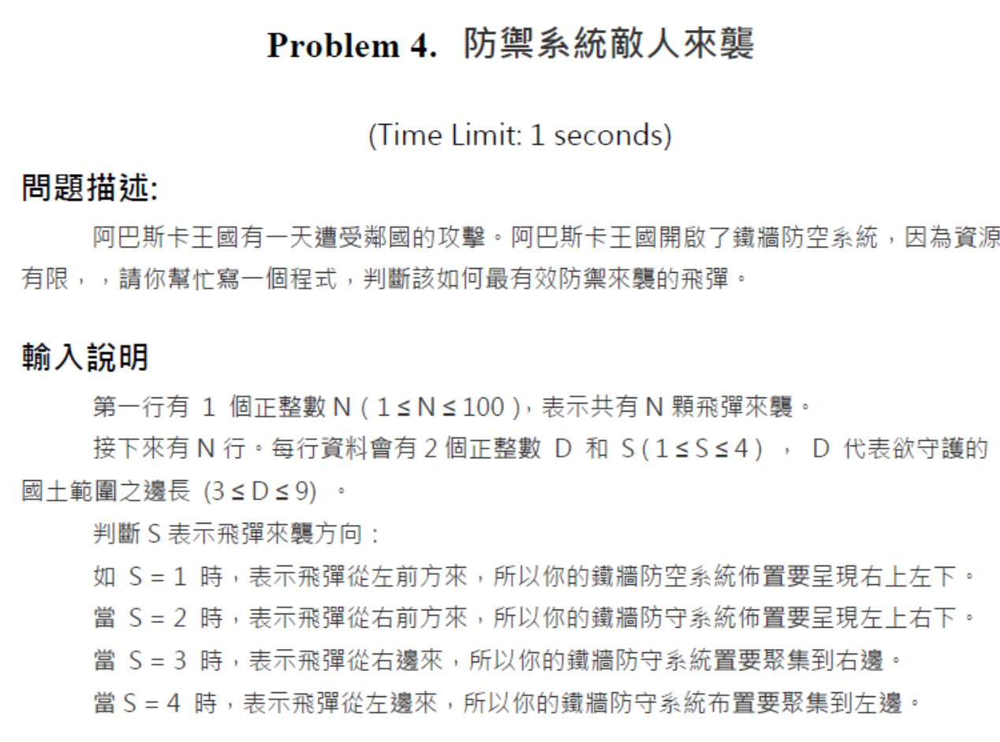
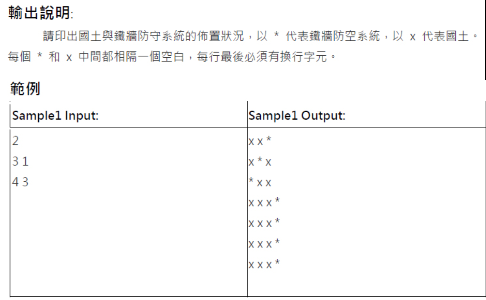
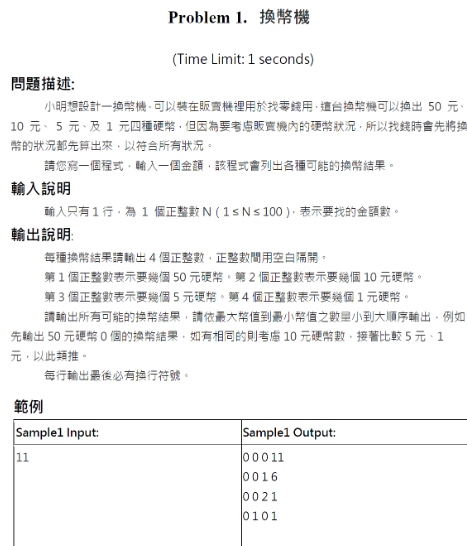

# 補充練習與歷屆題（第 0514 輪）

> [回到本輪目錄](../README.md)

**程式碼檔案：** [solution_1.cpp](solution_1.cpp)、[solution_2.cpp](solution_2.cpp)、[solution_3.cpp](solution_3.cpp)

---

## 2024/04 - Problem 4. 防禦系統敵人來襲

S=1，飛彈從左前方來，*要從右上到左下  
S=2，飛彈從右前方來，*要從左上到右下  
S=3，飛彈從右方來，*要聚集在最右邊  
S=4，飛彈從左方來，*要聚集在最左邊  
  
  

```cpp
#include <iostream>
using namespace std;

int main() {
    int N;
    cin >> N;

    while (N--) {
        int D, S;
        cin >> D >> S;

        char map[9][9]; // 3 <= D <= 9 題目保證

        // 初始化整張地圖為 'x'
        for (int i = 0; i < D; i++) {
            for (int j = 0; j < D; j++) {
                map[i][j] = 'x';
            }
        }

        // 根據 S 決定擺放 *
        if (S == 1) { // 右上到左下（反斜線方向）
            for (int i = 0; i < D; i++) {
                map[i][D - 1 - i] = '*';
            }
        }
        else if (S == 2) { // 左上到右下（正斜線方向）
            for (int i = 0; i < D; i++) {
                map[i][i] = '*';
            }
        }
        else if (S == 3) { // 最右邊一整列
            for (int i = 0; i < D; i++) {
                map[i][D - 1] = '*';
            }
        }
        else if (S == 4) { // 最左邊一整列
            for (int i = 0; i < D; i++) {
                map[i][0] = '*';
            }
        }

        // 輸出地圖
        for (int i = 0; i < D; i++) {
            for (int j = 0; j < D; j++) {
                cout << map[i][j];
                if (j < D - 1) cout << " ";
            }
            cout << endl;
        }
    }

    return 0;
}
```cpp

```cpp
//妍：S=1或2時，可用 i + j = D - 1 ;的條件來判斷要不要輸出j為*。
#include <iostream>
using namespace std;

int main() {
    int N;
    cin >> N;

    while (N--) {
        int D, S;
        cin >> D >> S;

        for (int i = 0; i < D; i++) {
            for (int j = 0; j < D; j++) {
                if ((S == 1 && i + j == D - 1) ||     // 右上到左下
                    (S == 2 && i == j) ||             // 左上到右下
                    (S == 3 && j == D - 1) ||         // 最右邊
                    (S == 4 && j == 0))               // 最左邊
                    cout << '*';
                else
                    cout << 'x';

                if (j < D - 1) cout << " ";
            }
            cout << endl;
        }
    }

    return 0;
}

```cpp

## 2024/05 - Problem 1. 換幣機

  

```cpp
#include <iostream>
using namespace std;

int main() {
    int N;
    cin >> N;

    for (int a = 0; a <= N / 50; ++a) { // a: 50元數量
        for (int b = 0; b <= (N - 50 * a) / 10; ++b) { // b: 10元
            for (int c = 0; c <= (N - 50 * a - 10 * b) / 5; ++c) { // c: 5元
                int d = N - 50 * a - 10 * b - 5 * c; // 剩下用 1元補足
                cout << a << " " << b << " " << c << " " << d << endl;
            }
        }
    }

    return 0;
}

```
