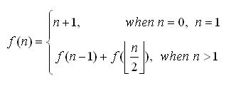

# 題目 12. 遞迴程式練習

> ITSA 基礎題練習 · 第 0514 輪 · [回到本輪目錄](../README.md)

**程式碼檔案：** [solution.cpp](solution.cpp)

---

問題描述：  
給定下列遞迴函式 :  
  
請計算出 f (k) 。  
輸入說明：  
輸入值為一個大於 1 的整數。  
輸出說明：  
f(k) 的計算結果。  
範例：  

| Sample Input | Sample Output |
|---|---|
| 10 | 60 |

| Sample Input | Sample Output |
|---|---|
| 12 | 94 |

```cpp
#include <iostream>
#include<cmath>

using namespace std;

int rec(int a);
int main()
{
    int n;
    while(cin >> n)
    {
        cout << rec(n) << endl;
    }
    return 0;
}

int rec(int a)
{
    if(a == 0 || a == 1)
    {
        return a + 1;
    }
    else
    {
        return rec(a - 1) + rec(ceil(a / 2)); //會回傳最接近a、且「大於或等於a」的最小整數
    }
}
```cpp
