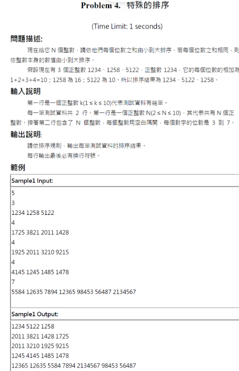

# 題目26. 各位數和排序

> ITSA基礎題練習 · 第0514輪 · [回到本輪目錄](../README.md)

**解題關鍵**：`int m = number[i];//複製一份出來計算counter[i] += m % 10;`

**程式碼檔案**：[solution_1.cpp](solution_1.cpp)、[solution_2.cpp](solution_2.cpp)

---

## 2024/05 - Problem 4. 特殊的排序

  

```cpp
#include <iostream>
#include <algorithm>

using namespace std;

int main()
{
    int N,m;
    cin>>m;
    while(m--){
        cin >> N;
        int number[10] = {0}; //宣告一個陣列存放數字（最多10個）
        int counter[10] = {0}; //存放每個數字的「位數總和」
        for(int i = 0; i < N; i++)
        {
            cin >> number[i];
            int m = number[i]; //複製一份出來計算（不改原本的 number）
            while(m > 0)
            {
                counter[i] += m % 10; //取出個位數加進去
                m /= 10;  //去掉個位數（向右移一位）
            }
        }
         for (int i = 0; i < N - 1; i++) {
            for (int j = i + 1; j < N; j++) {
                if (counter[i] > counter[j] || (counter[i] == counter[j] && number[i] > number[j])) {
                    //如果第 i 個數字的「數字總和」比第 j 個大 → 要交換
                    //如果「數字總和相等」，但原始數字比較大 → 也要交換
                    swap(counter[i], counter[j]);
                    swap(number[i], number[j]);
                }
            }
        }
        for(int i = 0; i < N; i++)
        {
            cout << number[i];
            if(i != N - 1){
                cout << " "; // 數字中間加空格
            }
            else{
                cout << endl;
            }
        }
    }
    return 0;
}

```cpp

問題描述 ：  
輸入一整數N及N個整數，請依照十進位中各位數字和由小到大排序輸出。如果各位數字和相等則比較數值由小到大排列。例如：9122的各位數字和為9+1+2+2=14、3128的各位數字和為3+1+2+8=14而5112的各位數字和為5+1+1+2=9。所以輸入9122 3128 5112需輸出5112 3128 9122，這是因為5112(9) < 3128(14) < 9122(14)，其中又因為3128與9122兩者的各位數字和都是14，所以將 數值小的3128放前面。  
輸入說明 ：  
第一行輸入 N ，第二行輸入 N 個整數，用空白隔開，N<10。  
輸出說明 ：  
輸出排序結果。  
範例 ：  

| 輸入範例 | 輸出範例 |
|---|---|
| 3<br>9122 3128 5112 | 5112 3128 9122 |
| 4<br>1725 3821 2011 1428 | 2011 3821 1428 1725 |

```cpp
#include <iostream>
#include <algorithm>

using namespace std;

int main()
{
    int N;
    cin >> N;
    int number[10] = {0}; //宣告一個陣列存放數字（最多10個）
    int counter[10] = {0}; //存放每個數字的「位數總和」
    for(int i = 0; i < N; i++)
    {
        cin >> number[i];
        int m = number[i]; //複製一份出來計算（不改原本的 number）
        while(m > 0)
        {
            counter[i] += m % 10; //取出個位數加進去
            m /= 10;  //去掉個位數（向右移一位）
        }
    }
     for (int i = 0; i < N - 1; i++) {
        for (int j = i + 1; j < N; j++) {
            if (counter[i] > counter[j] || (counter[i] == counter[j] && number[i] > number[j])) {
                //如果第 i 個數字的「數字總和」比第 j 個大 → 要交換
                //如果「數字總和相等」，但原始數字比較大 → 也要交換
                swap(counter[i], counter[j]);
                swap(number[i], number[j]);
            }
        }
    }
    for(int i = 0; i < N; i++)
    {
        cout << number[i];
        if(i != N - 1){
            cout << " "; // 數字中間加空格
        }
        else{
            cout << endl;
        }
    }
    return 0;
}
```cpp
