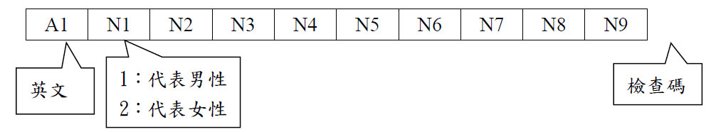
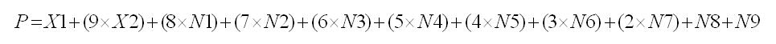

# 題目 29. 身分證驗證器

> ITSA 基礎題練習 · 第 0514 輪 · [回到本輪目錄](../README.md)

**解題關鍵：** `getline int n[9]={0};//用來裝後面9位數字`

**程式碼檔案：** [solution.cpp](solution.cpp)

---

問題描述：  
設計一個程式可以檢查身分證字號的正確性 ( 應檢查性別欄及檢查碼是否正確 ) 。  
身分證字號共有十個碼，且有一定的編碼規則，其檢查編碼的規則如下：  
其中檢查碼的計算方法如下：  
  
Step 1: 根據下表查出第一碼的英文字母對應到的兩位數代號。  

| 字母 | A | B | C | D | E | F | G | H | J | K | L | M | N | P | Q | R | S | T | U | V | X | Y | W | Z | I | O |
|---|---|---|---|---|---|---|---|---|---|---|---|---|---|---|---|---|---|---|---|---|---|---|---|---|---|---|
| 代號 | 10 | 11 | 12 | 13 | 14 | 15 | 16 | 17 | 18 | 19 | 20 | 21 | 22 | 23 | 24 | 25 | 26 | 27 | 28 | 29 | 30 | 31 | 32 | 33 | 34 | 35 |

Step 2: 令此代號之十位數為 X1 ，個位數為 X2 。例如 Y 的代號 31 ，則 X1=3 ； X2=1 。  
Step 3: 運用下面的公式計算之。如果 P 可以被 10 整除，則此組身份證號碼是對的，反之則是錯的。  
  
輸入說明：  
輸入身分證字號，第一碼為英文大寫。  
輸出說明：  
若身分證字號正確，印出「CORRECT!!!」；不正確則印出「WRONG!!!」。  
範例：  

| Sample Input | Sample Output |
|---|---|
| A123456789 | CORRECT!!! |
| L163690274 | WRONG!!! |

- 英文字母對應成兩位數（A → 10，B → 11，...，Z → 33）  
- 對應的兩位數拆成：  
- 十位數 x1：直接加入總和  
- 個位數 x2：乘以 9 再加入總和  
- 再加上後 9 碼數字，分別乘以：8, 7, 6, ..., 1  
- 最後總和 p，如果能被 10 整除就是合法的身分證  

```cpp
#include <iostream>
#include <string>

using namespace std;

int main()
{
    char letter[26] = {'A', 'B', 'C', 'D', 'E', 'F', 'G', 'H', 'J', 'K', 'L', 'M', 'N', 'P', 'Q', 'R', 'S', 'T', 'U', 'V', 'X', 'Y', 'W', 'Z', 'I', 'O'};
    int number[26] = {10, 11, 12, 13, 14, 15, 16, 17, 18, 19, 20, 21, 22, 23, 24, 25, 26, 27, 28, 29, 30, 31, 32, 33, 34, 35};
    int n[9] = {0};  // 用來裝後面 9 位數字
    string input;
    int x1 = 0, x2 = 0;
    int p = 0;
    while(getline(cin, input))
    {
        for(int i = 0; i < 26; i++)
        {
		        char c = input[0]; //把輸入的「身分證字號」的第一個字母抓出來，放到變數 c 裡。
            if(c == letter[i])
            {
                x1 = number[i] / 10;
                x2 = number[i] % 10 * 9;
                //(1)：x2 = number[i] % 10;
            } //例如 A → 10，十位是 1、個位是 0 → x1 = 1, x2 = 0*9 = 0
        }
        // 把 input[1] 到 input[9] 這九個字元轉成數字
        for(int i = 1; i < 10; i++)
        {
            n[i - 1] = input[i] - '0';
            //(2)：n[i]=input[i]-'0';
        }
        p = x1 + x2 + n[0] * 8 + n[1] * 7 + n[2] * 6 + n[3] * 5 + n[4] * 4 + n[5] * 3 + n[6] * 2 + n[7] + n[8];
        //(3)：p = x1 + x2*9 + n[1] * 8 + n[2] * 7 + n[3] * 6 + n[4] * 5 + n[5] * 4 + n[6] * 3 + n[7] * 2 + n[8] + n[9];
        if(p % 10 == 0)
        {
            cout << "CORRECT!!!" << endl;
        }
        else
        {
            cout << "WRONG!!!" << endl;
        }
    }
    return 0;
}
```cpp
